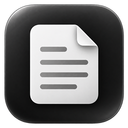

<p align="center">
  
</p>

<h1 align="center">Stash</h1>

<p align="center">
  <strong>Capture it. Stash it. Personalize it. Find it instantly.</strong><br>
  <em>A high-performance, local-first floating workspace utility for macOS and Windows.</em>
</p>

<p align="center">
  <a href="https://tauri.app/"></a>
  <a href="https://react.dev/"></a>
  <a href="https://www.typescriptlang.org/"></a>
  <a href="https://www.rust-lang.org/"></a>
  <a href="https://sqlite.org/"></a>
  <a href="LICENSE"></a>
</p>

---

## Overview

**Stash** is a production-quality, local-first desktop application combining the tactile immediacy of floating sticky notes with the organizational depth of a modern knowledge workspace. It is built natively on top of **Tauri 2 (Rust)** and **React 18 + TypeScript**, backed by an embedded SQLite database with WAL mode and SQLite FTS5 for sub-millisecond search.

---

## Key Features

### 1. Instant Capture & Detached Floating Windows
- **Global Hotkey (`Cmd/Ctrl + Shift + N`)**: Launch a lightweight, focused floating stash note instantly from any app on your system.
- **Detached Native Windows**: Notes exist as independent OS windows with persistent geometry, multi-monitor memory, and native Always-on-Top pins.
- **Window Shade (Roll-Up)**: Double-click the titlebar or press the roll-up chevron to collapse any floating stash note into a discrete 36px titlebar.

### 2. Ghost Mode & Translucency
- **Dynamic Desktop Overlay**: Adjust window opacity from solid (100%) down to ethereal ghost mode (30%) with live slider and preset shortcuts (Solid, Glass, Phantom, Ghost).
- **Peek-on-Hover**: When ghost mode is enabled, hovering your mouse automatically restores 100% opacity for effortless reading and editing.
- **Framer Motion Micro-Interactions**: Ambient ethereal border aura, HUD feedback badge, and animated ghost iconography.

### 3. Personalization & Aesthetic Suite
- **Note Emoji & Icon Persona**: Choose from curated expressive icons (🚀, 💡, 🎯, ⚡, 💻, 📝, ☕, 🎨, etc.) or input custom Unicode glyphs. Renders across titlebars, OS window chrome, and library cards.
- **Tactile Paper Textures**: Subtle, distraction-free textured backdrops that blend with any note hue:
  - `Clean Plain`: Minimalist solid paper.
  - `Dot Grid`: Bullet journal subtle dot matrix.
  - `Ruled Notebook`: Classic notebook lines.
  - `Engineering Graph`: Technical square grid.
  - `Blueprint Mesh`: Architectural dual-grid mesh.
- **Typography Personas**: Toggle reading fonts between **Modern Sans** (Inter), **Classic Serif** (Editorial), **Dev Monospace** (Code-centric), and **Handwritten** (Creative italic).
- **Window Frame Styles**: Choose between **Classic Rim**, **Glass Acrylic** (frosted edge), **Neon Ambient** (color-matched glow), and **Borderless Hairline**.
- **Curated Tone Palette**: 9 handcrafted dual-mode color schemes (`Paper`, `Sand`, `Lemon`, `Sage`, `Mint`, `Sky`, `Lavender`, `Rose`, `Graphite`).

### 4. Interactive Note Widgets & Mini-Apps
Attach interactive, draggable utility widgets to any note surface:
- **Currency & Crypto Converter**: Live exchange rates across fiat and crypto pairs.
- **Market Tickers**: Real-time asset pricing and 24h market trends.
- **Quick Calculator**: Desktop math scratchpad with history.
- **Focus & Pomodoro Timer**: Work/break intervals with count-up stopwatch.
- **World Clocks**: Instant timezone comparisons with global UTC offsets.
- **Unit Converter**: Length, weight, temperature, and data conversion.
- **Tally & Goal Counter**: Habit tracking with visual increments.
- **Countdown Timer**: Real-time countdowns to events and project deadlines.
- **Kanban Board**: Drag-and-drop task columns (To Do, In Progress, Done).
- **Habit Tracker**: Weekly visual streak checkboxes.
- **Color Palette**: Hex swatches with 1-click clipboard copying.
- **Web Browser (PiP)**: Embedded web viewer with detachable Picture-in-Picture window.

### 5. Smart Rich-Text Editor
- **Tiptap Engine**: Checklists, code blocks, blockquotes, tables, hyperlinks, custom font sizes, text alignments, and slash command menus (`/`).
- **Inline Math Scratchpad**: Type any math expression ending with `=` (e.g., `120 * 1.15 =`) to instantly calculate and append the answer.
- **Note Templates**: 1-click starters for Meeting Notes, Daily Journal, Quick Scratchpad, Habit Checklist, and Weekly Sprint.
- **Formatting Dock**: Floating formatting bar with smooth tooltips, minimizable dock toggle, and keyboard shortcuts.
- **Global Scaling**: Zoom in and out globally (`Ctrl/Cmd + =` and `Ctrl/Cmd + -`).

### 6. Security, Due Dates & Data Integrity
- **Per-Note PIN Lock**: Protect sensitive stashes with numeric PINs and session memory.
- **Due Dates & Reminders**: Visual badges for overdue, today, tomorrow, and upcoming milestones.
- **Revision History**: Automatic checkpoints on edit and window close with 1-click restore.
- **Full Text Search (FTS5)**: Instant search indexing titles, note bodies, and tags.
- **100% Offline & Private**: Zero cloud dependency. Data is stored locally in SQLite with WAL mode.
- **Data Export**: Export any note as Markdown (`.md`) or perform complete JSON database backups.

---

## System Architecture

```text
Stash Architecture
├── Presentation Layer (React 18 + TypeScript + Tailwind CSS + Radix UI + Framer Motion)
│   ├── Main Library View (Sidebar, Search, Grid/List Collections, Filter Tabs)
│   ├── Detached Floating Windows (Custom Titlebar, Window Shade, Ghost Mode)
│   ├── Personalization Suite (NotePersonaModal, Paper Patterns, Typography, Frames)
│   ├── Interactive Widgets Canvas (Financial, Productivity, Clocks, Kanban, PiP Browser)
│   └── Rich Text Editor (Tiptap, Inline Math, Slash Menu, Formatting Dock)
│
├── Frontend Application Layer
│   ├── Zustand UI Store (Global zoom, active filters, selections, theme)
│   ├── Typed IPC Bridge (stash-ipc.ts communicating with Rust via Tauri invoke)
│   ├── Window Manager (Tauri WebviewWindow spawner, geometry synchronization)
│   └── Event Bus (Cross-window update synchronization)
│
├── Native Backend Layer (Rust + Tauri 2)
│   ├── Tauri Commands (CRUD, Soft Delete, Checkpoints, Window States, JSON Backup)
│   ├── Multi-Window Controller (Window sizing, scaling factors, always-on-top)
│   ├── System Tray Controller (Tray menu, quick stash spawner)
│   └── Global Shortcut Daemon (Cmd/Ctrl + Shift + N)
│
└── Persistence Layer (SQLite + WAL)
    ├── Schema Migrations (v1 through v4 durable versioning)
    ├── Notes & Window States Tables
    ├── Tags & NoteTags Normalized Associations
    ├── Checkpoint Revisions Table (Bounded retention per note)
    └── FTS5 Full-Text Search Virtual Table with Automatic Triggers
```

---

## Getting Started

### Prerequisites

- **Node.js**: `v20+` (v22.x LTS recommended)
- **pnpm**: `v10+`
- **Rust**: `1.77.2+` with `cargo` and MSVC (Windows) or Xcode Command Line Tools (macOS)
- **WebView2**: Built into Windows 10/11

### Installation

```bash
# 1. Clone the repository
git clone https://github.com/itsnothyun/Stash.git
cd Stash

# 2. Install frontend dependencies
pnpm install

# 3. Launch in desktop development mode (Vite + Tauri)
pnpm tauri dev
```

To run a browser-only preview:
```bash
pnpm dev
```

### Verification & Tests

```bash
# Run TypeScript compilation check
pnpm tsc --noEmit

# Run Vite production bundle build
pnpm build

# Run Rust backend test suite
cd src-tauri
cargo test
```

---

## Keyboard Shortcuts

| Shortcut | Action | Scope |
| :--- | :--- | :--- |
| `Cmd/Ctrl + Shift + N` | **Quick Stash** (Instant floating note) | **Global System-Wide** |
| `Cmd/Ctrl + K` | **Command Palette** | In-app |
| `Cmd/Ctrl + F` | **Focus Search** | Library View |
| `Cmd/Ctrl + =` | **Zoom In** (Global scale up) | In-app |
| `Cmd/Ctrl + -` | **Zoom Out** (Global scale down) | In-app |
| `Cmd/Ctrl + 0` | **Reset Zoom** (100% scale) | In-app |
| `Cmd/Ctrl + ,` | **Settings & Data Backup** | In-app |
| `Cmd/Ctrl + W` | **Close Note Window** | In-app |
| `Cmd/Ctrl + D` | **Duplicate Note** | Contextual |
| `Cmd/Ctrl + Shift + A`| **Archive Note** | Contextual |
| `/` | **Slash Command Menu** | Empty block in Editor |
| `Double Click Titlebar`| **Window Shade** (Roll-up) | Floating Stash |
| `Enter` / `Double Click`| **Open Floating Stash** | Library Note Card |

---

## Data & Privacy

- **Local Storage**: All notes and settings are stored locally on your machine:
  - Windows: `%APPDATA%\com.stash.desktop\stash.db`
  - macOS: `~/Library/Application Support/com.stash.desktop/stash.db`
  - Linux: `~/.config/com.stash.desktop/stash.db`
- **Telemetry**: Stash has **0 analytics**, **0 tracking**, and makes **0 network calls** for your notes.

---

## License

This project is licensed under the [MIT License](LICENSE).
