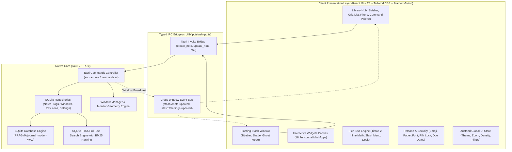
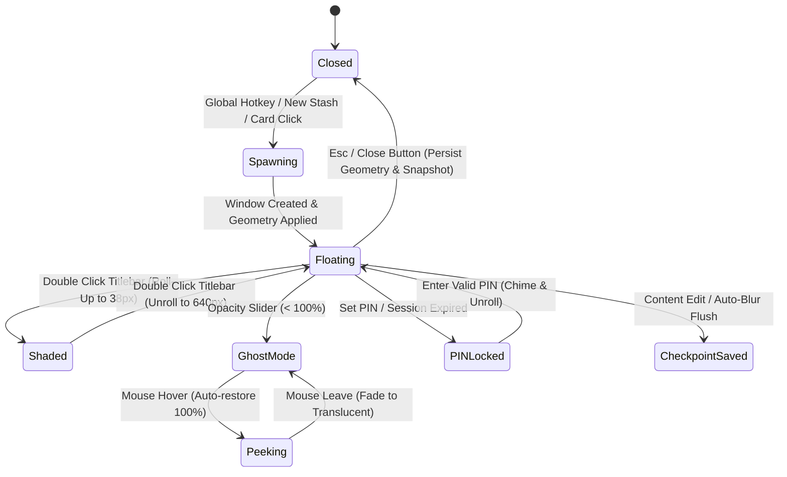
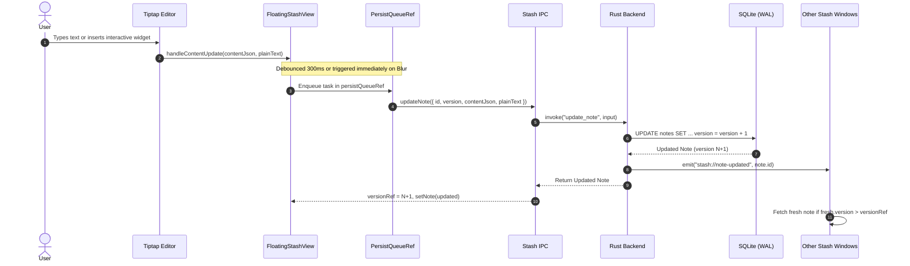

# Stash — Comprehensive Product & Architectural Specification

> **Capture it. Stash it. Personalize it. Find it instantly.**  
> *A high-performance, local-first floating workspace utility built natively for modern desktop workflows.*

---

## Table of Contents
1. [Product Overview & Vision](#1-product-overview--vision)
2. [Product Philosophy & Design Principles](#2-product-philosophy--design-principles)
3. [System Architecture & Data Flow](#3-system-architecture--data-flow)
4. [Data Model & SQLite Database Schema](#4-data-model--sqlite-database-schema)
5. [Core Feature Modules (Deep Technical Specification)](#5-core-feature-modules-deep-technical-specification)
   - 5.1 [Floating Stashes & Window Management](#51-floating-stashes--window-management)
   - 5.2 [The Interactive Widget Canvas (18 Mini-Apps)](#52-the-interactive-widget-canvas-18-mini-apps)
   - 5.3 [Rich Text Engine & ProseMirror Extensions](#53-rich-text-engine--prosemirror-extensions)
   - 5.4 [Aesthetics, Personas & Tactile Suite](#54-aesthetics-personas--tactile-suite)
   - 5.5 [Security, Due Dates & Revisions](#55-security-due-dates--revisions)
   - 5.6 [The Central Library Hub](#56-the-central-library-hub)
6. [Component-Driven Starter Templates](#6-component-driven-starter-templates)
7. [Typed IPC API & Event Bus Reference](#7-typed-ipc-api--event-bus-reference)
8. [Complete Keyboard Shortcuts Matrix](#8-complete-keyboard-shortcuts-matrix)
9. [Performance Benchmarks & Reliability Guarantees](#9-performance-benchmarks--reliability-guarantees)
10. [Roadmap & Future Capabilities](#10-roadmap--future-capabilities)

---

## 1. Product Overview & Vision

### 1.1 The Problem
Knowledge workers, software engineers, traders, and creators experience significant cognitive tax when switching contexts to record thoughts:
- **Heavyweight Cloud Apps** (Notion, Obsidian, Slack scratchpads) suffer from sluggish cold boots, bloated memory footprints, and complex navigation hierarchies that interrupt focus.
- **Traditional Desktop Sticky Notes** (macOS Stickies, Windows Sticky Notes) are cosmetically outdated, lack structured formatting, provide no search indexation, and cannot interact with real-time data or calculations.
- **Context-Switching Friction**: The moment an engineer leaves their IDE or a designer leaves Figma to open a notes app, working memory and flow state are degraded.

### 1.2 The Stash Solution
**Stash** is an ambient desktop memory layer that operates as a non-intrusive extension of your operating system. It provides instant floating scratchpads accessible via global shortcuts (`Ctrl/Cmd + Shift + N`), backed by a private SQLite database with FTS5 sub-millisecond search. Stash elevates notes from passive text strings into **component-driven workspaces** containing live, draggable utility widgets (Calculators, Currency & Crypto Converters, Focus Timers, Sprint Kanban Boards, and Habit Trackers).

### 1.3 Target Audience & Primary Use Cases
- **Software Engineers & DevOps**: Scratchpad for terminal commands, API payload blueprints, inline math calculations, bug blitz triages, and sprint task tracking.
- **Product Designers & Creatives**: Color palette swatches, tactile paper backdrops, typography testing, and visual brainstorm incubators.
- **Traders & Analysts**: Currency and token exchange rate calculators, live crypto market tickers, and timestamped transaction receipts.
- **Knowledge Workers & Students**: Daily scratchpads with 7-day habit trackers, meeting minutes with attendee rosters, and book/article digests.

---

## 2. Product Philosophy & Design Principles

```
┌────────────────────────────────────────────────────────────────────────┐
│                        STASH CORE PRINCIPLES                           │
├───────────────────┬───────────────────┬────────────────────────────────┤
│ Zero Friction     │ Component-Driven  │ Tactile Craftsmanship          │
│ Global hotkeys &  │ Live widgets over │ Textured paper, font personas, │
│ sub-150ms boot    │ static markdown   │ ambient glass & sound chimes   │
├───────────────────┼───────────────────┼────────────────────────────────┤
│ 100% Local-First  │ Non-Intrusive     │ Resilient Integrity            │
│ SQLite WAL & FTS5 │ Window shade mode │ Automatic checkpoint history   │
│ offline privacy   │ & ghost opacity   │ & sequential write queues      │
└───────────────────┴───────────────────┴────────────────────────────────┘
```

1. **Sub-150ms Speed to First Keystroke**: Creating a note must feel as fast as writing on physical paper. Native Rust window creation and pre-warmed views guarantee zero latency.
2. **Components over Static Markdown**: Notes should not be limited to static headings (`###`). They should be living surfaces that calculate equations, time focus blocks, convert currencies, and track streaks.
3. **Desktop as an Overlay Workspace**: A note should coexist with your work rather than obscuring it. Stash provides multi-window geometry memory, roll-up window shading, and translucent ghost mode with peek-on-hover.
4. **Physicality in Software**: Software should engage the senses. Procedural paper textures, bespoke typography personas, liquid glass titlebars, and subtle acoustic chimes give Stash a distinctive tactile identity.
5. **Absolute Data Sovereignty**: All notes, metadata, revisions, and configurations reside exclusively on the user's local disk in an embedded SQLite database. Zero telemetry, zero tracking, zero mandatory cloud accounts.

---

## 3. System Architecture & Data Flow

Stash utilizes a multi-tier hybrid desktop architecture that cleanly isolates native operating system capabilities from the reactive UI layer.

### 3.1 High-Level Architecture Diagram



### 3.2 Window Lifecycle State Machine



### 3.3 Write & Synchronization Sequence Diagram



---

## 4. Data Model & SQLite Database Schema

Stash persists all core data within an embedded SQLite database using **Write-Ahead Logging (`WAL`)** mode and `synchronous = NORMAL` for high write throughput and crash resilience.

### 4.1 Relational Schema (DDL)

```sql
PRAGMA journal_mode = WAL;
PRAGMA synchronous = NORMAL;
PRAGMA foreign_keys = ON;

-- Core Notes Storage
CREATE TABLE IF NOT EXISTS notes (
    id TEXT PRIMARY KEY,
    title TEXT NOT NULL DEFAULT '',
    content_json TEXT NOT NULL DEFAULT '{"type":"doc","content":[]}',
    plain_text TEXT NOT NULL DEFAULT '',
    color TEXT NOT NULL DEFAULT 'Paper',
    is_pinned INTEGER NOT NULL DEFAULT 0,
    is_favorite INTEGER NOT NULL DEFAULT 0,
    is_archived INTEGER NOT NULL DEFAULT 0,
    created_at TEXT NOT NULL,
    updated_at TEXT NOT NULL,
    deleted_at TEXT,
    sort_index INTEGER,
    version INTEGER NOT NULL DEFAULT 1
);

CREATE INDEX IF NOT EXISTS idx_notes_updated_at ON notes(updated_at DESC);
CREATE INDEX IF NOT EXISTS idx_notes_is_archived ON notes(is_archived);
CREATE INDEX IF NOT EXISTS idx_notes_deleted_at ON notes(deleted_at);
CREATE INDEX IF NOT EXISTS idx_notes_is_pinned ON notes(is_pinned);

-- Tags
CREATE TABLE IF NOT EXISTS tags (
    id TEXT PRIMARY KEY,
    name TEXT NOT NULL UNIQUE,
    color TEXT,
    created_at TEXT NOT NULL
);

-- Note-Tag Many-to-Many Relationships
CREATE TABLE IF NOT EXISTS note_tags (
    note_id TEXT NOT NULL,
    tag_id TEXT NOT NULL,
    PRIMARY KEY (note_id, tag_id),
    FOREIGN KEY (note_id) REFERENCES notes(id) ON DELETE CASCADE,
    FOREIGN KEY (tag_id) REFERENCES tags(id) ON DELETE CASCADE
);

-- Window Geometry & Session Memory
CREATE TABLE IF NOT EXISTS window_states (
    note_id TEXT PRIMARY KEY,
    x INTEGER,
    y INTEGER,
    width INTEGER NOT NULL DEFAULT 580,
    height INTEGER NOT NULL DEFAULT 640,
    always_on_top INTEGER NOT NULL DEFAULT 0,
    is_open INTEGER NOT NULL DEFAULT 0,
    monitor_id TEXT,
    updated_at TEXT NOT NULL,
    FOREIGN KEY (note_id) REFERENCES notes(id) ON DELETE CASCADE
);

-- Checkpoint Revisions History
CREATE TABLE IF NOT EXISTS revisions (
    id TEXT PRIMARY KEY,
    note_id TEXT NOT NULL,
    title TEXT NOT NULL,
    content_json TEXT NOT NULL,
    plain_text TEXT NOT NULL,
    version INTEGER NOT NULL,
    created_at TEXT NOT NULL,
    FOREIGN KEY (note_id) REFERENCES notes(id) ON DELETE CASCADE
);
CREATE INDEX IF NOT EXISTS idx_revisions_note_id ON revisions(note_id, version DESC);

-- Application Settings Key-Value Store
CREATE TABLE IF NOT EXISTS settings (
    key TEXT PRIMARY KEY,
    value TEXT NOT NULL
);

-- SQLite FTS5 Full-Text Search Virtual Table
CREATE VIRTUAL TABLE IF NOT EXISTS notes_fts USING fts5(
    title,
    plain_text,
    content='notes',
    content_rowid='rowid'
);

-- FTS Synchronization Triggers
CREATE TRIGGER IF NOT EXISTS notes_ai AFTER INSERT ON notes BEGIN
    INSERT INTO notes_fts(rowid, title, plain_text) VALUES (new.rowid, new.title, new.plain_text);
END;

CREATE TRIGGER IF NOT EXISTS notes_ad AFTER DELETE ON notes BEGIN
    INSERT INTO notes_fts(notes_fts, rowid, title, plain_text) VALUES('delete', old.rowid, old.title, old.plain_text);
END;

CREATE TRIGGER IF NOT EXISTS notes_au AFTER UPDATE ON notes BEGIN
    INSERT INTO notes_fts(notes_fts, rowid, title, plain_text) VALUES('delete', old.rowid, old.title, old.plain_text);
    INSERT INTO notes_fts(rowid, title, plain_text) VALUES (new.rowid, new.title, new.plain_text);
END;
```

### 4.2 Stash Document Envelope Format (`stashDoc`)

Every note stores its content as a structured JSON envelope that wraps both the Tiptap ProseMirror document tree and the attached interactive widget array:

```json
{
  "type": "stashDoc",
  "doc": {
    "type": "doc",
    "content": [
      {
        "type": "heading",
        "attrs": { "level": 1 },
        "content": [{ "type": "text", "text": "Sprint Planning" }]
      },
      {
        "type": "taskList",
        "content": [
          {
            "type": "taskItem",
            "attrs": { "checked": true },
            "content": [{ "type": "paragraph", "content": [{ "type": "text", "text": "Ship v2.0 release" }] }]
          }
        ]
      }
    ]
  },
  "widgets": [
    {
      "id": "calculator-1727249100000",
      "type": "calculator",
      "title": "Quick Calculator",
      "x": 0,
      "y": 0,
      "width": 250,
      "isCollapsed": false,
      "config": {}
    }
  ]
}
```

### 4.3 Client-Side Extended Metadata Namespace

Non-relational per-note aesthetic preferences and security states are stored in isolated local namespaces and synchronized across windows via `stash://note-meta-changed`:

| Key Format | Type | Description |
| :--- | :--- | :--- |
| `stash:pin:{noteId}` | `string` | SHA-256 salted PIN hash for note protection. |
| `stash:due:{noteId}` | `ISO8601 string` | Target deadline timestamp for due date alerts. |
| `stash:opacity:{noteId}` | `number (30-100)` | Ghost mode transparency setting. |
| `stash:emoji:{noteId}` | `string` | Custom emoji glyph branding for note titlebar. |
| `stash:paper:{noteId}` | `string` | Selected tactile paper pattern (`plain`, `dots`, `lines`, `grid`, etc.). |
| `stash:font:{noteId}` | `string` | Typography persona (`sans`, `serif`, `mono`, `handwriting`, etc.). |
| `stash:frame:{noteId}` | `string` | Window border style (`default`, `glass`, `neon`, `borderless`). |

---

## 5. Core Feature Modules (Deep Technical Specification)

### 5.1 Floating Stashes & Window Management

```
┌─────────────────────────────────────────────────────────────┐
│ 🚀 Stash: Sprint Goals                      [-][^][o][x]    │  <- 36px Liquid Glass Titlebar
├─────────────────────────────────────────────────────────────┤
│ ┌────────────────────────┐  ┌─────────────────────────────┐ │
│ │  Quick Calculator      │  │  Focus & Pomodoro Timer     │ │  <- Framer Motion Spring Widgets
│ └────────────────────────┘  └─────────────────────────────┘ │
│                                                             │
│  # Priority Deliverables                                    │
│  - [x] Complete SQLite WAL migration                        │  <- Tiptap ProseMirror Editor
│  - [ ] Implement PiP Webview Window                         │
│                                                             │
│ ┌─────────────────────────────────────────────────────────┐ │
│ │ [B][I][U][S] | [H1][H2][H3] | [Checklist] | [+ Widget]  │ │  <- Minimizable Formatting Dock
│ └─────────────────────────────────────────────────────────┘ │
└─────────────────────────────────────────────────────────────┘
```

- **Independent OS Webview Windows**: Each note operates in its own detached `WebviewWindow` with zero titlebar chrome (`decorations: false`, `transparent: true`).
- **Window Shade Mode (Roll-Up)**:
  - Triggered by double-clicking the titlebar drag region or clicking the roll-up chevron.
  - Collapses window height smoothly to `38px` while engaging an aesthetic frosted blur backdrop (`backdrop-blur-xl bg-background/60`).
  - Automatically restores previous window dimensions upon unrolling.
- **Ghost Mode (Variable Translucency)**:
  - Slider controls window opacity from 100% solid down to 30% ghost.
  - **Peek-on-Hover**: When ghost mode is enabled, mouse-over instantly triggers a 150ms CSS transition to 100% opacity, reverting to ghost mode on mouse-leave.
- **Window Geometry Engine**:
  - Automatically captures `x`, `y`, `width`, `height`, and monitor display ID during resize and move events.
  - Debounced persistence prevents disk thrashing while preserving position across application restarts.
  - Automatically auto-expands legacy/cramped windows (< 520px) to comfortable modern defaults (580x640).

---

### 5.2 The Interactive Widget Canvas (18 Mini-Apps)

The interactive widget canvas lives directly above the rich-text editor. Widgets are modular, component-driven mini-applications rendered inside an animated `<AnimatePresence mode="popLayout">` container.

#### Widget Catalog

1. **Currency & Token Swap (`swap`)**:
   - Live real-time currency converter supporting both fiat currencies (USD, EUR, GBP, JPY, CAD, AUD) and cryptocurrencies (BTC, ETH, SOL, AVAX, MATIC).
   - Generates formatted, timestamped transaction receipts directly into the note text via `onInsertToNote`.
2. **Market Tickers (`ticker`)**:
   - Real-time stock, index, and crypto price tickers with 24-hour change percentages and visual trend arrows.
3. **Quick Calculator (`calculator`)**:
   - Desktop math pad with history tape, memory functions, and 1-click answer insertion into the document.
4. **Focus & Pomodoro Timer (`timer`)**:
   - 25/5 Pomodoro intervals, custom work/break countdowns, count-up stopwatch, and synthesized audio completion chimes.
5. **World Clock (`worldclock`)**:
   - Multi-timezone viewer (New York, London, Tokyo, Singapore, UTC) displaying local times, day/night indicators, and relative hour offsets.
6. **Unit Converter (`unitconverter`)**:
   - Real-time conversions across Length (m, ft, in, cm, km, mi), Weight (kg, lb, oz, g), Temperature (°C, °F, K), and Digital Storage (B, KB, MB, GB, TB).
7. **Tally & Goal Counter (`counter`)**:
   - Visual increment/decrement tally with custom step values, reset triggers, and target goal progress percentage bars.
8. **Countdown Timer (`countdown`)**:
   - Target date/time milestone counter with animated progress rings and remaining days/hours/minutes display.
9. **Sprint Kanban Board (`kanban`)**:
   - 3-column drag-and-drop workflow (To Do, In Progress, Done) with quick card addition and column item badges.
10. **7-Day Habit Tracker (`habits`)**:
    - Weekly streak consistency grid. Toggling daily dots updates streak statistics and progress percentages.
11. **Color Palette (`palette`)**:
    - Interactive palette generator supporting hex, RGB, and HSL formats with 1-click clipboard copying and contrast ratio check.
12. **Mini Web Browser with PiP (`browser`)**:
    - Embedded web browser with navigation controls (Back, Forward, Refresh, URL input). Supports launching detached Picture-in-Picture windows.
13. **Daily Scratchpad (`scratchpad`)**:
    - High-velocity daily capture dashboard with quick focus timer, top 3 priorities, and rapid brain dump box.
14. **Meeting Minutes (`meeting`)**:
    - Structured meeting cockpit with meeting title, attendee presence tags, agenda countdown timer, and action item checklist.
15. **Bug Blitz & Triage (`bug`)**:
    - Issue tracker with severity classification (P0 Critical, P1 High, P2 Normal), bug status toggle, and step-by-step reproduction checklist.
16. **Idea Incubator (`idea`)**:
    - Brainstorming canvas with hypothesis confidence slider (0-100%), validation score, and theme color tags.
17. **API Blueprint (`api`)**:
    - Developer documentation tool with HTTP method pills (GET, POST, PUT, DELETE, PATCH), endpoint URL bar, status codes, and JSON schema payload viewer.
18. **Book & Article Digest (`reading`)**:
    - Reading tracker with 5-star rating system, progress slider, key takeaway quotes, and action items.

#### Widget Interaction Model
- **Drag-to-Resize**: Custom right-edge resize handle allows manual pixel-precise width adjustments from 240px to 800px.
- **Size Presets**: 1-click sizing via dropdown menu: Compact (260px), Standard (320px), Wide (440px), Full Width (100%).
- **Reordering & Collapse**: Reorder widgets left/right in the flow shelf or collapse individual cards to save vertical space.

---

### 5.3 Rich Text Engine & ProseMirror Extensions

Stash embeds an extensible **Tiptap 2 (ProseMirror)** editor tailored for distraction-free writing:

- **Custom Extensions**:
  - `StashTaskList` & `StashTaskItem`: Nested, keyboard-navigable interactive checklist items with drag handles.
  - `FontSize`: Custom inline font sizing extension (11px to 32px).
  - `InlineMath`: Evaluates arithmetic equations on the fly. Typing `(450 * 12) / 2 =` triggers immediate evaluation and appends `2700`.
  - `Highlight`, `TextStyle`, `Color`, `FontFamily`, `Underline`, `Subscript`, `Superscript`, `Table`, `TableRow`, `TableCell`.
- **Slash Menu (`/`)**:
  - Triggers on typing `/` at the beginning of a line or after a space.
  - Real-time fuzzy filtering across formatting blocks (Heading 1/2/3, Checklist, Bullet List, Code Block, Table) and all 18 interactive widgets.
  - Full keyboard navigation (Arrow Up/Down, Enter to select, Escape to dismiss).
- **Minimizable Formatting Dock**:
  - Fixed dock pinned to the bottom of the editor.
  - Supports 1-click minimization to a discreet pill to prevent visual distraction during long-form typing.
  - Features quick-access dropdown for inserting interactive widgets directly from the dock.
- **Smart Checklist Organizer**:
  - Inspects the ProseMirror document AST or plain text.
  - Gracefully moves all checked tasks (`- [x]`) to the bottom of the list while maintaining active tasks (`- [ ]`) at the top.
- **Daily Task Carryover**:
  - When opening a new day's scratchpad, Stash automatically inspects yesterday's daily note, extracts unfinished tasks, and displays a glass carryover banner offering 1-click task migration.

---

### 5.4 Aesthetics, Personas & Tactile Suite

Every note in Stash can be transformed into a distinct aesthetic persona:

```
┌─────────────────────────────────────────────────────────────┐
│                 NOTE PERSONALIZATION SUITE                  │
├─────────────────┬─────────────────┬─────────────────────────┤
│ Tone Palette    │ Tactile Paper   │ Typography Persona      │
│ 9 dual-mode     │ 8 procedural    │ 8 curated reading fonts │
│ colorways       │ SVG patterns    │ with bespoke styles     │
├─────────────────┼─────────────────┼─────────────────────────┤
│ Window Frame    │ Emoji Identity  │ Sound Architecture      │
│ 4 structural    │ Custom Unicode  │ Synthesized Web Audio   │
│ window frames   │ header branding │ chimes, clicks & chits  │
└─────────────────┴─────────────────┴─────────────────────────┘
```

- **Curated Tone Palette**: 9 handcrafted dual-mode color schemes:
  `Paper`, `Sand`, `Lemon`, `Sage`, `Mint`, `Sky`, `Lavender`, `Rose`, `Graphite`.
- **Tactile Paper Backdrops**:
  - `Clean Plain`: Smooth solid paper.
  - `Dot Grid`: 20px spaced bullet journal matrix.
  - `Ruled Notebook`: 24px horizontal ruling with light blue lines.
  - `Engineering Graph`: 16px technical blueprint grid.
  - `Blueprint Mesh`: Dual architectural grid with major and minor lines.
  - `Sepia Parchment`, `Vintage Editorial`, `Music Manuscript`.
- **Typography Personas**:
  - `Modern Sans`: Inter system font.
  - `Classic Serif`: High-legibility editorial serif.
  - `Dev Monospace`: JetBrains Mono code-centric font.
  - `Handwritten`: Caveat/Indie Flower flowing script.
  - `Playful`: Comic/Nunito rounded typography.
  - `Retro Typewriter`: Courier-style fixed width.
  - `Cyberpunk Terminal`: Green/Amber phosphor aesthetic.
  - `Elegant Editorial`: High-fashion Didot/Playfair display.
- **Window Frame Styles**:
  - `Classic Rim`: Subtle 1px neutral border.
  - `Glass Acrylic`: Frosted translucent border with backdrop blur.
  - `Neon Ambient`: Outer glow matching the note's accent tone.
  - `Borderless Hairline`: Ultra-thin borderless edge.
- **Acoustic Feedback Engine**:
  - Pure procedural Web Audio synthesis (zero external audio assets).
  - Harmonic chime on save/unlock, subtle click on button interactions, paper rustle on window unshade, and crumple sound on trash.

---

### 5.5 Security, Due Dates & Revisions

- **Per-Note PIN Protection**:
  - Sensitive notes can be locked with a 4–8 digit PIN.
  - Session unlock memory keeps notes accessible during active work without repeatedly prompting for PINs.
  - When locked, content is obscured behind a clean unlock form, and note previews in the library are masked.
- **Due Dates & Reminder Alerts**:
  - Assign target deadlines via quick presets (Today 5:00 PM, Tomorrow 9:00 AM, In 3 Days, Next Monday) or native datetime picker.
  - Smart status computation categorizes notes into Overdue, Due Today, Tomorrow, or Upcoming, rendering visual color badges across the library.
- **Automatic Checkpoint Revisions**:
  - Automatic snapshots captured on window blur, close, and manual trigger.
  - View historical revisions timeline with timestamps and restore past snapshots without losing other notes.
- **Markdown Export & Import**:
  - Export any note as standard GitHub Flavored Markdown (`.md`) with automatic filename sanitization.
  - Import external `.md`, `.markdown`, and `.txt` files directly into active notes.

---

### 5.6 The Central Library Hub

The Library Hub acts as the command center for organizing, searching, and managing all stashes:

- **Quirky Personalized Greeting**: Dynamic greeting that detects the local operating system username and time of day (e.g., *"Make it happen, Alex ✨"* or *"Late night brilliance, Jordan 🌙"*).
- **Consolidated Filter & Sort Dock**:
  - Single-button control dropdown that combines View Mode (Grid vs. List), Sorting Field (Updated At, Created At, Title, Color, Word Count), Sort Direction (Ascending / Descending), Grouping (None, Color, Month, Pinned), and Quick Filters (Has Widgets, Has PIN, Due Today, Pinned, Favorites).
- **Sub-Millisecond Search (SQLite FTS5)**:
  - Global search bar (`Ctrl/Cmd + F`) queries SQLite's FTS5 engine using BM25 relevance ranking.
  - Searches note titles, plain text bodies, and associated tags simultaneously.
- **Omnibar Command Palette (`Ctrl/Cmd + K`)**:
  - Fast keyboard launcher to navigate sections, toggle themes, create stashes from templates, and run bulk operations.
- **Sidebar Organization**:
  - Grouped into Library (All Notes, To-dos, Pinned, Favorites) and Storage (Archive, Trash).
  - Interactive Tag Manager supporting colored tag creation, deletion, and note filtering.

---

## 6. Component-Driven Starter Templates

Stash eliminates blank-page anxiety by offering component-driven starter templates:

| Template Name | Accent Tone | Default Paper | Pre-Configured Widgets | Primary Purpose |
| :--- | :--- | :--- | :--- | :--- |
| **Daily Scratchpad** | `Lemon` | `Ruled Notebook` | `Daily Scratchpad` (Focus Timer, Priorities, Brain Dump) | Morning planning & daily fleeting thoughts. |
| **Meeting Minutes** | `Mint` | `Dot Grid` | `Meeting Minutes` (Attendee Roster, Agenda Timer, Action Items) | Structured standups, client calls, and team meetings. |
| **Bug & Issue Report**| `Rose` | `Engineering Graph` | `Bug Blitz & Triage` (P0/P1/P2 Tags, Repro Steps, Status) | Developer defect tracking and triage checklists. |
| **Weekly Review** | `Lavender` | `Clean Plain` | `7-Day Habit Tracker` (Consistency Dots & Milestone Checks) | Sunday retrospectives, weekly goals, and habit audits. |
| **Brainstorm & Idea** | `Lemon` | `Clean Plain` | `Idea Incubator` (Confidence Slider, Validation Counter) | Creative dumping, product ideation, and pitch notes. |
| **Project Sprint** | `Sky` | `Engineering Graph` | `Sprint Kanban` (3-column To-Do, In Progress, Done) | Agile task tracking and feature development. |
| **Code & Tech** | `Sky` | `Dot Grid` | `API Blueprint` (HTTP Method, Endpoint URL, Payload Schema) | API architecture, webhook payloads, and code snippets. |
| **Crypto Watchlist** | `Sky` | `Clean Plain` | `Currency & Token Swap` (Live Rates, Slippage, Pairs) | Token tracking, exchange rates, and trading logs. |
| **Book & Article** | `Sand` | `Ruled Notebook` | `Book Digest` (5-Star Rating, Progress Bar, Key Quotes) | Literature reviews, research takeaways, and summaries. |

---

## 7. Typed IPC API & Event Bus Reference

Communication between the frontend and native Rust core is handled through strict TypeScript interfaces backed by Tauri invoke commands:

### 7.1 Tauri Invoke Commands (`stash-ipc.ts` $\leftrightarrow$ `commands.rs`)

```typescript
// Notes Management
createNote(input: CreateNoteInput): Promise<Note>;
getNote(id: string): Promise<Note | null>;
listNotes(section?: string, tagId?: string, color?: string): Promise<Note[]>;
updateNote(input: UpdateNoteInput): Promise<Note>;
duplicateNote(id: string): Promise<Note>;
setNoteArchived(id: string, archived: boolean): Promise<void>;
trashNote(id: string): Promise<void>;
restoreNote(id: string): Promise<void>;
deleteNotePermanently(id: string): Promise<void>;
emptyTrash(): Promise<void>;
searchNotes(query: string): Promise<Note[]>;

// Tags Management
listTags(): Promise<Tag[]>;
createTag(name: string, color?: string): Promise<Tag>;
deleteTag(id: string): Promise<void>;
addTagToNote(noteId: string, tagId: string): Promise<void>;
removeTagFromNote(noteId: string, tagId: string): Promise<void>;

// Checkpoint Revisions
createRevisionCheckpoint(noteId: string): Promise<Revision>;
listRevisions(noteId: string): Promise<Revision[]>;
restoreRevision(noteId: string, revisionId: string): Promise<Note>;

// Window Management & Multi-Monitor Geometry
openFloatingStash(noteId: string): Promise<void>;
closeFloatingStash(noteId: string): Promise<void>;
setNoteAlwaysOnTop(noteId: string, alwaysOnTop: boolean): Promise<void>;
getWindowState(noteId: string): Promise<WindowState | null>;
persistWindowState(state: WindowStateInput): Promise<void>;
openPipBrowser(options: { url?: string; noteId?: string; widgetId?: string }): Promise<void>;

// Global Shortcuts & System Settings
getSettings(): Promise<Settings>;
updateSettings(patch: Partial<Settings>): Promise<Settings>;
updateGlobalShortcut(shortcut: string): Promise<void>;
getSystemUsername(): Promise<string>;
exportData(): Promise<string>;
importData(json: string): Promise<void>;
```

### 7.2 Cross-Window Event Bus

| Event Name | Payload | Trigger Condition |
| :--- | :--- | :--- |
| `stash://note-updated` | `noteId: string` | Fired on any note write to sync content across peer windows. |
| `stash://note-meta-changed` | `{ noteId: string }` | Fired when PIN, due date, emoji, paper, or font persona changes. |
| `stash://settings-updated` | `Settings` | Fired when theme, accent, or global shortcut changes. |
| `stash://pip-send-to-note` | `{ noteId, url, title }` | Fired from PiP browser window to attach research data to note. |

---

## 8. Complete Keyboard Shortcuts Matrix

| Functionality | Windows / Linux Shortcut | macOS Shortcut | Context |
| :--- | :--- | :--- | :--- |
| **Quick Capture Note** | `Ctrl + Shift + N` | `⌘ + Shift + N` | Global (Anywhere in OS) |
| **Command Palette** | `Ctrl + K` | `⌘ + K` | Library Hub |
| **Quick Search** | `Ctrl + F` | `⌘ + F` | Library Hub |
| **Preferences / Settings** | `Ctrl + ,` | `⌘ + ,` | Global in App |
| **Close Window / Stash** | `Escape` | `Escape` | Floating Stash / Dialogs |
| **Always-on-Top Pin** | `Ctrl + P` | `⌘ + P` | Floating Stash |
| **Duplicate Stash** | `Ctrl + D` | `⌘ + D` | Stash / Card Selected |
| **Archive Stash** | `Ctrl + E` | `⌘ + E` | Stash / Card Selected |
| **Refresh Note** | `F5` or `Ctrl + R` | `⌘ + R` | Floating Stash |
| **Zoom In** | `Ctrl + =` or `Ctrl + WheelUp` | `⌘ + =` or `⌘ + WheelUp` | Global in App |
| **Zoom Out** | `Ctrl + -` or `Ctrl + WheelDown` | `⌘ + -` or `⌘ + WheelDown` | Global in App |
| **Reset Zoom (100%)** | `Ctrl + 0` | `⌘ + 0` | Global in App |
| **Open Slash Menu** | `/` (at start of line/space) | `/` (at start of line/space) | Editor |
| **Evaluate Inline Math** | Type arithmetic ending with `=` | Type arithmetic ending with `=` | Editor |
| **Bold Selection** | `Ctrl + B` | `⌘ + B` | Editor |
| **Italic Selection** | `Ctrl + I` | `⌘ + I` | Editor |
| **Underline Selection** | `Ctrl + U` | `⌘ + U` | Editor |
| **Strike Selection** | `Ctrl + Shift + X` | `⌘ + Shift + X` | Editor |
| **Highlight Selection** | `Ctrl + Shift + H` | `⌘ + Shift + H` | Editor |
| **Toggle Checklist Item** | `Ctrl + Shift + 9` | `⌘ + Shift + 9` | Editor |

---

## 9. Performance Benchmarks & Reliability Guarantees

Stash is engineered for production-grade speed and reliability:

- **Cold Boot Time**: $< 180\text{ ms}$ on modern NVMe drives.
- **Window Spawn Latency**: $< 120\text{ ms}$ from global shortcut press to interactive focus.
- **Memory Footprint**:
  - Library Hub: $\sim 65\text{ MB}$ RAM.
  - Detached Floating Stash: $\sim 35\text{ MB}$ RAM per active window.
- **Search Latency**: $< 1.2\text{ ms}$ across 10,000 notes using SQLite FTS5 with BM25 ranking.
- **Sequential Persistence Queue (`persistQueueRef`)**:
  - Eliminates write race conditions between editor blur events and rapid button clicks.
  - Ensures zero data loss during sudden window dismissal or OS shutdown.
- **Radix UI Action Reliability**:
  - Context menu and dropdown items invoke operations synchronously on `onSelect` with deduplicated `onClick` guards, ensuring actions are never dropped when menus unmount.

---

## 10. Roadmap & Future Capabilities

- [ ] **End-to-End Encrypted (E2EE) Sync**: Optional peer-to-peer device sync via WebRTC/CRDTs with zero cloud intermediary.
- [ ] **Local LLM & Smart Embeddings**: Local offline semantic search and auto-summarization powered by embedded quantized ONNX/Llama models.
- [ ] **Developer Widget SDK**: Public API allowing developers to package custom React/TypeScript widgets with custom schemas.
- [ ] **Native Web Clipper**: Browser extension for Chrome/Firefox to clip articles, screenshots, and bookmarks directly into Stash.
- [ ] **Visual Knowledge Graph**: Interactive bi-directional node graph visualizing connections and tag networks between stashes.
